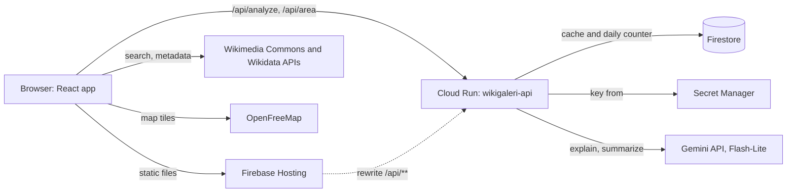
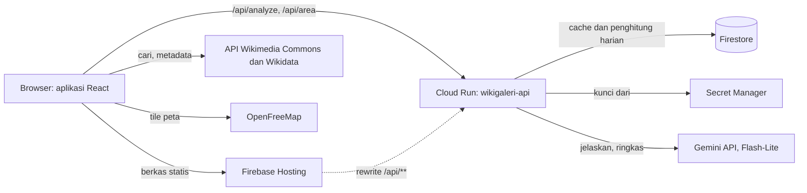

<div align="center">

# WikiGaleri

**A gallery for Wikimedia Commons: find free media, understand it, and reuse it with the right credit.**
**Galeri untuk Wikimedia Commons: temukan media bebas, pahami isinya, dan pakai dengan kredit yang benar.**

[Live demo](https://wikigaleri.web.app) · [English](#english) · [Bahasa Indonesia](#bahasa-indonesia)

Built by **Team Metafora** with Google Gemini and Firebase for the Google Cloud AI Builder Cup.
Dibuat oleh **Tim Metafora** dengan Google Gemini dan Firebase untuk Google Cloud AI Builder Cup.

</div>

---

## English

### The problem

Wikimedia Commons holds more than a hundred million free files, but two things get in the way of using them:

1. **They are hard to find and understand.** Search is built for editors, and a file's page is dense with metadata.
2. **License rules are easy to get wrong.** A file may need credit, may forbid commercial use, or may require you to share your changes under the same license. Missing the credit line or mixing up two licenses is common, and it can take down a student's thesis figure or a small business's brochure.

### What WikiGaleri does

WikiGaleri is a web app that closes that gap. Live at **https://wikigaleri.web.app**.

- Search Commons by keyword, username, category, live feed or a random pick, and narrow results by media type.
- See a map of geotagged photos around any spot, with an optional 3D view of buildings. It opens on the National Monument (Monas), Jakarta.
- Ask Gemini to explain a file in plain language and sum up what its license allows.
- Copy a ready-made credit line (TASL: Title, Author, Source, License) in one click, in English or Indonesian.
- Save files, usernames and categories as bookmarks, and back them up as a JSON file.
- Use it in Indonesian or English, in light or dark mode, on a phone or a desktop.

### Features

| Feature | What it does |
|---|---|
| Gallery and search | Browse images, audio, video, documents and more, with curated topics, a Live Feed of new uploads and a random tab |
| Search by user or category | Open a contributor's uploads and talk page, or walk a category tree through subcategories and parent categories |
| Media-type filter | Narrow results to images, video, audio or documents |
| File details | Download sizes, source info, categories and usage, version history and discussion, with a reading mode for documents |
| Gemini assistant | Two short sections per file: what the file is, and what you can do with it |
| Credit line | A TASL credit line in plain text, Markdown, HTML or wikitext, plus a quick-copy modal |
| Nearby map | Find Commons photos around a point, with an area summary from Gemini (or a local summary when no key is set) |
| Bookmarks | Save files, usernames and categories in your browser, and export or import them as JSON |
| Guides | In-app guides for CC licenses, Wikimedia terms and what WikiGaleri is |
| PDF report | Save the Gemini analysis of a file as a PDF |

### How Google AI is used

Gemini 3.1 Flash-Lite (through the Gemini API) reads the official Commons metadata (title, description, categories, license, size, location) and writes **what this file is**: a plain-language explanation, key facts and ideas for using it. License terms and the ready-to-copy credit line live in the separate CC Attribution tab, built from the Commons license data rather than written by Gemini.

For the Nearby map, Gemini also summarizes the area around the chosen point from the titles and descriptions of nearby photos.

The app can reach Gemini in two ways, chosen at build time with `VITE_AI_MODE`:

| Mode | How it works | Status |
|---|---|---|
| `direct` (default) | You paste your own free Gemini key from [Google AI Studio](https://aistudio.google.com/apikey). It stays in your browser (`localStorage`) and goes only to Google. | Used while Cloud Run is being set up |
| `api` | Our own API on Cloud Run calls Gemini. No key is entered in the browser, answers are cached in Firestore, and a daily limit applies to real Gemini calls. | Code complete in `server/`, to be switched on after deploy |

In both modes the file explanation starts by itself as soon as you open a file, and the result is kept in memory until you refresh. When Gemini cannot answer (no key, quota, an error), the app shows a clearly labelled summary built from the Commons metadata and license rules, plus the reason and a retry button.

Every AI result carries a notice, with a link to the [Wikimedia AI guidelines](https://meta.wikimedia.org/wiki/Artificial_intelligence/Guidelines). Gemini can be wrong or miss context. The license summary is a guide, not legal advice. Always check the file page on Commons before you reuse anything.

### Architecture and deployment



The diagram shows the `api` mode. In `direct` mode the browser calls the Gemini API itself with the user's key and the Cloud Run, Firestore and Secret Manager parts are not used.

The site is a single-page React build served by **Firebase Hosting** (project `wikigaleri`). Wikimedia and map requests go straight from the browser. In `api` mode Gemini goes through **Cloud Run** (`server/`): Firebase Hosting rewrites `/api/**` to the `wikigaleri-api` service, which keeps the Gemini key in **Secret Manager**, stores answers in **Firestore** so each file is explained once, and enforces rate limits and a daily limit of 300 real Gemini calls. The Gemini key comes from an AI Studio project without billing, so it stays on the free tier. Cloud Run is capped at one instance and scales to zero.

Setup, cost guards and the full deploy steps are in [server/README.md](server/README.md). In short:

```bash
gcloud run deploy wikigaleri-api --source server --region asia-southeast1 ...
npm run build
firebase deploy --only hosting,firestore:rules
```

### Tech stack

- React 19, TypeScript, Vite
- Tailwind CSS 4
- MapLibre GL (nearby map, OpenFreeMap tiles)
- Google Gemini API (model `gemini-3.1-flash-lite`, with `gemini-3.5-flash-lite` as the fallback), called from the server
- Cloud Run (Node.js and Express in `server/`), Firestore (answer cache), Secret Manager
- Wikimedia Commons and Wikidata APIs
- jsPDF and qrcode for the PDF report
- Firebase Hosting for the site

### Run locally

**Prerequisites:** Node.js 22 or newer.

```bash
git clone https://github.com/affandymurad/wikigaleri.git
cd wikigaleri
npm install
npm run dev
```

Open http://localhost:3000. Search, filters, credit lines, the map and bookmarks work right away.

**Gemini features.** In the default `direct` mode, click "Add Gemini key" in the top bar and paste your own key from [Google AI Studio](https://aistudio.google.com/apikey). Never commit a key to this repository.

To try the `api` mode locally, run the API in a second terminal and start the app with the mode switched on:

```bash
cd server
npm install
GEMINI_API_KEY=your-key npm run dev
```

```bash
VITE_AI_MODE=api npm run dev
```

Vite forwards `/api` to the API (port 8080). Locally the cache lives in memory. See [server/README.md](server/README.md) for all settings.

### Scripts

| Command | Purpose |
|---|---|
| `npm run dev` | Start the dev server on port 3000 |
| `npm run build` | Build for production into `dist/` |
| `npm run preview` | Preview the production build |
| `npm run lint` | Type-check with TypeScript |

The API in `server/` has its own `npm run dev`, `npm run build` and `npm run lint`.

### Project structure

```
src/
  components/   UI: gallery, detail modal, nearby map, bookmarks, guides
  hooks/        Commons gallery, language, dark mode
  services/     Wikimedia API client and the client for our Gemini API
  i18n/         Indonesian and English strings
  utils/        License helpers, credit line and PDF export
server/         Cloud Run API: prompts, Gemini call, Firestore cache, limits
```

### Credits and disclaimer

WikiGaleri is an independent project. It is not made, endorsed or run by the Wikimedia Foundation. Every file keeps the license chosen by its author, so follow it when you reuse a file.

Media shown in the app comes from [Wikimedia Commons](https://commons.wikimedia.org). Map data by [OpenStreetMap](https://www.openstreetmap.org/copyright) contributors, tiles by [OpenFreeMap](https://openfreemap.org).

### Team

**Team Metafora**: Affandy Murad (Team Leader) and Ahmad Fauzi (Member). Profile: [affandymurad.github.io](https://affandymurad.github.io/).

---

## Bahasa Indonesia

### Masalahnya

Wikimedia Commons menyimpan lebih dari seratus juta berkas bebas, tetapi ada dua hal yang menghalangi orang memakainya:

1. **Sulit dicari dan dipahami.** Pencariannya dibuat untuk penyunting, dan halaman berkas penuh metadata.
2. **Aturan lisensi gampang salah.** Sebuah berkas mungkin wajib dikreditkan, melarang pemakaian komersial, atau mewajibkan hasil olahanmu dibagikan dengan lisensi yang sama. Kredit yang terlewat atau dua lisensi yang tertukar itu umum terjadi, dan bisa merugikan, misalnya pada gambar skripsi mahasiswa atau brosur usaha kecil.

### Apa yang dilakukan WikiGaleri

WikiGaleri adalah aplikasi web yang menutup celah itu. Tersedia di **https://wikigaleri.web.app**.

- Cari di Commons lewat kata kunci, nama pengguna, kategori, Live Feed, atau pilihan acak, lalu saring berdasarkan jenis media.
- Lihat peta foto bergeotag di sekitar suatu tempat, dengan tampilan 3D gedung sebagai pilihan. Peta dibuka di Monumen Nasional (Monas), Jakarta.
- Minta Gemini menjelaskan isi berkas dengan bahasa sehari-hari dan meringkas apa yang diizinkan lisensinya.
- Salin teks kredit siap pakai (TASL: Judul, Pembuat, Sumber, Lisensi) dengan satu klik, dalam bahasa Indonesia atau Inggris.
- Simpan berkas, nama pengguna, dan kategori sebagai markah, lalu cadangkan sebagai berkas JSON.
- Tersedia dalam bahasa Indonesia dan Inggris, mode terang dan gelap, di ponsel maupun desktop.

### Fitur

| Fitur | Fungsi |
|---|---|
| Galeri dan pencarian | Jelajahi gambar, audio, video, dokumen, dan lainnya, lengkap dengan topik pilihan, Live Feed unggahan terbaru, dan tab acak |
| Cari lewat pengguna atau kategori | Buka unggahan dan halaman pembicaraan seorang kontributor, atau telusuri pohon kategori lewat subkategori dan kategori induk |
| Filter jenis media | Saring hasil menjadi gambar, video, audio, atau dokumen |
| Detail berkas | Ukuran unduhan, info sumber, kategori dan penggunaan, riwayat versi, serta diskusi, dengan mode baca untuk dokumen |
| Asisten Gemini | Dua bagian singkat per berkas: apa isi berkas ini, dan boleh dipakai untuk apa |
| Teks kredit | Teks kredit TASL dalam teks biasa, Markdown, HTML, atau wikitext, plus jendela salin cepat |
| Peta terdekat | Temukan foto Commons di sekitar satu titik, dengan ringkasan area dari Gemini (atau ringkasan lokal bila kunci belum diisi) |
| Markah | Simpan berkas, nama pengguna, dan kategori di browsermu, lalu ekspor atau impor sebagai JSON |
| Panduan | Panduan lisensi CC, ketentuan Wikimedia, dan penjelasan tentang WikiGaleri langsung di aplikasi |
| Laporan PDF | Simpan analisis Gemini sebuah berkas sebagai PDF |

### Cara Google AI dipakai

Gemini 3.1 Flash-Lite (lewat Gemini API) membaca metadata resmi dari Commons (judul, deskripsi, kategori, lisensi, ukuran, lokasi), lalu menulis **apa isi berkas ini**: penjelasan bahasa awam, fakta penting, dan ide pemakaian. Ketentuan lisensi dan teks kredit siap salin ada di tab CC Attribution tersendiri, dibangun dari data lisensi Commons, bukan ditulis oleh Gemini.

Untuk peta terdekat, Gemini juga merangkum area di sekitar titik pilihan dari judul dan deskripsi foto di sekitarnya.

Aplikasi bisa memakai Gemini dengan dua cara, dipilih saat build lewat `VITE_AI_MODE`:

| Mode | Cara kerja | Status |
|---|---|---|
| `direct` (bawaan) | Kamu menempelkan kunci Gemini gratis milikmu dari [Google AI Studio](https://aistudio.google.com/apikey). Kunci tetap di browsermu (`localStorage`) dan hanya dikirim ke Google. | Dipakai selama Cloud Run disiapkan |
| `api` | API kami sendiri di Cloud Run yang memanggil Gemini. Tidak ada kunci yang dimasukkan di browser, jawaban disimpan di cache Firestore, dan ada batas harian untuk panggilan Gemini yang sebenarnya. | Kode lengkap di `server/`, diaktifkan setelah deploy |

Di kedua mode, penjelasan berkas berjalan otomatis begitu berkas dibuka, dan hasilnya disimpan di memori sampai halaman dimuat ulang. Bila Gemini tidak bisa menjawab (belum ada kunci, kuota, error), aplikasi menampilkan ringkasan berlabel jelas yang dibuat dari metadata Commons dan aturan lisensi, beserta alasannya dan tombol coba lagi.

Setiap hasil AI disertai catatan, dengan tautan ke [pedoman AI Wikimedia](https://meta.wikimedia.org/wiki/Artificial_intelligence/Guidelines). Gemini bisa salah atau melewatkan konteks. Ringkasan lisensi hanya penuntun, bukan nasihat hukum. Selalu cek halaman berkas di Commons sebelum memakainya kembali.

### Arsitektur dan deployment



Diagram menunjukkan mode `api`. Di mode `direct`, browser memanggil Gemini API sendiri dengan kunci pengguna, dan bagian Cloud Run, Firestore, serta Secret Manager tidak dipakai.

Situsnya berupa build React satu halaman yang disajikan oleh **Firebase Hosting** (proyek `wikigaleri`). Permintaan ke Wikimedia dan peta langsung dari browser. Di mode `api`, Gemini lewat **Cloud Run** (`server/`): Firebase Hosting mengarahkan `/api/**` ke layanan `wikigaleri-api`, yang menyimpan kunci Gemini di **Secret Manager**, menyimpan jawaban di **Firestore** agar tiap berkas dijelaskan sekali, serta menerapkan batas laju dan batas harian 300 panggilan Gemini yang sebenarnya. Kunci Gemini berasal dari proyek AI Studio tanpa billing, jadi tetap di tier gratis. Cloud Run dibatasi satu instance dan turun ke nol saat tidak dipakai.

Pengaturan, pembatas biaya, dan langkah deploy lengkap ada di [server/README.md](server/README.md). Ringkasnya:

```bash
gcloud run deploy wikigaleri-api --source server --region asia-southeast1 ...
npm run build
firebase deploy --only hosting,firestore:rules
```

### Teknologi

- React 19, TypeScript, Vite
- Tailwind CSS 4
- MapLibre GL (peta terdekat, tile OpenFreeMap)
- Google Gemini API (model `gemini-3.1-flash-lite`, dengan `gemini-3.5-flash-lite` sebagai cadangan), dipanggil dari server
- Cloud Run (Node.js dan Express di `server/`), Firestore (cache jawaban), Secret Manager
- API Wikimedia Commons dan Wikidata
- jsPDF dan qrcode untuk laporan PDF
- Firebase Hosting untuk situs

### Menjalankan secara lokal

**Prasyarat:** Node.js 22 atau lebih baru.

```bash
git clone https://github.com/affandymurad/wikigaleri.git
cd wikigaleri
npm install
npm run dev
```

Buka http://localhost:3000. Pencarian, filter, teks kredit, peta, dan markah langsung berfungsi.

**Fitur Gemini.** Di mode `direct` bawaan, klik "Tambah kunci Gemini" di bilah atas lalu tempel kunci milikmu dari [Google AI Studio](https://aistudio.google.com/apikey). Jangan pernah meng-commit kunci ke repositori ini.

Untuk mencoba mode `api` secara lokal, jalankan API di terminal kedua lalu mulai aplikasi dengan mode itu:

```bash
cd server
npm install
GEMINI_API_KEY=kunci-kamu npm run dev
```

```bash
VITE_AI_MODE=api npm run dev
```

Vite meneruskan `/api` ke API (port 8080). Secara lokal cache disimpan di memori. Semua pengaturan ada di [server/README.md](server/README.md).

### Perintah

| Perintah | Fungsi |
|---|---|
| `npm run dev` | Menjalankan server pengembangan di port 3000 |
| `npm run build` | Membangun versi produksi ke folder `dist/` |
| `npm run preview` | Melihat hasil build produksi |
| `npm run lint` | Memeriksa tipe dengan TypeScript |

API di `server/` punya `npm run dev`, `npm run build`, dan `npm run lint` sendiri.

### Struktur proyek

```
src/
  components/   Antarmuka: galeri, modal detail, peta terdekat, markah, panduan
  hooks/        Galeri Commons, bahasa, mode gelap
  services/     Klien API Wikimedia dan klien untuk API Gemini kami
  i18n/         Teks bahasa Indonesia dan Inggris
  utils/        Pembantu lisensi, teks kredit, dan ekspor PDF
server/         API Cloud Run: prompt, panggilan Gemini, cache Firestore, pembatas
```

### Kredit dan penafian

WikiGaleri adalah proyek independen. Aplikasi ini tidak dibuat, didukung, atau dikelola oleh Wikimedia Foundation. Setiap berkas tetap tunduk pada lisensi pilihan pembuatnya, jadi ikuti lisensi itu saat memakainya kembali.

Media di aplikasi berasal dari [Wikimedia Commons](https://commons.wikimedia.org). Data peta oleh kontributor [OpenStreetMap](https://www.openstreetmap.org/copyright), tile oleh [OpenFreeMap](https://openfreemap.org).

### Tim

**Tim Metafora**: Affandy Murad (Ketua Tim) dan Ahmad Fauzi (Anggota). Profil: [affandymurad.github.io](https://affandymurad.github.io/).
