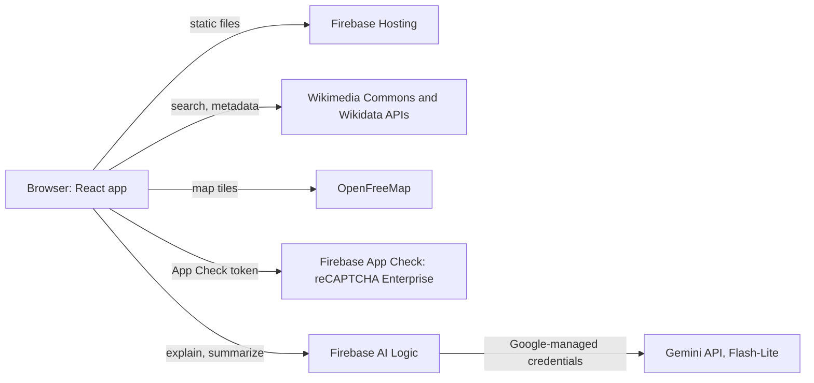
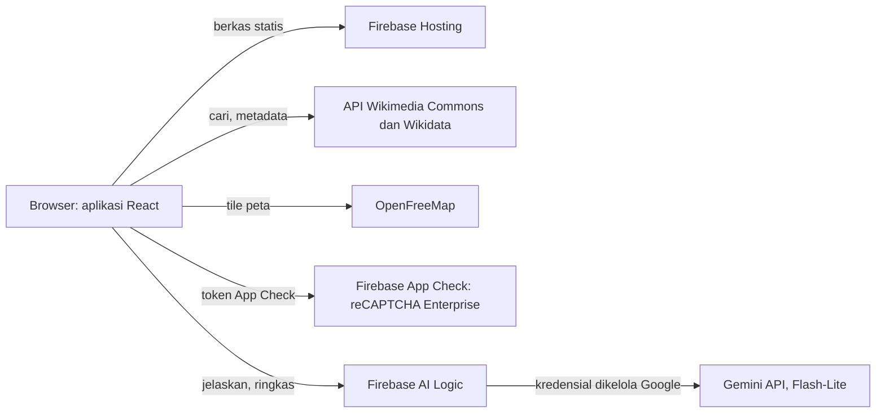

<div align="center">

# WikiGaleri

**A gallery for Wikimedia Commons: find free media, understand it, and reuse it with the right credit.**
**Galeri untuk Wikimedia Commons: temukan media bebas, pahami isinya, dan pakai dengan kredit yang benar.**

[Live demo](https://wikigaleri.web.app) · [English](#english) · [Bahasa Indonesia](#bahasa-indonesia)

Built by **Team Metafora** with Google Gemini and Firebase for the Google Cloud AI Builder Cup.
Dibuat oleh **Tim Metafora** dengan Google Gemini dan Firebase untuk Google Cloud AI Builder Cup.

</div>

---

## English

### The problem

Wikimedia Commons holds more than a hundred million free files, but two things get in the way of using them:

1. **They are hard to find and understand.** Search is built for editors, and a file's page is dense with metadata.
2. **License rules are easy to get wrong.** A file may need credit, may forbid commercial use, or may require you to share your changes under the same license. Missing the credit line or mixing up two licenses is common, and it can take down a student's thesis figure or a small business's brochure.

### What WikiGaleri does

WikiGaleri is a web app that closes that gap. Live at **https://wikigaleri.web.app**.

- Search Commons by keyword, username, category, live feed or a random pick, and narrow results by media type.
- See a map of geotagged photos around any spot, with an optional 3D view of buildings. It opens on the National Monument (Monas), Jakarta.
- Ask Gemini to explain a file in plain language and sum up what its license allows.
- Copy a ready-made credit line (TASL: Title, Author, Source, License) in one click, in English or Indonesian.
- Save files, usernames and categories as bookmarks, and back them up as a JSON file.
- Use it in Indonesian or English, in light or dark mode, on a phone or a desktop.

### Features

| Feature | What it does |
|---|---|
| Gallery and search | Browse images, audio, video, documents and more, with curated topics, a Live Feed of new uploads and a random tab |
| Search by user or category | Open a contributor's uploads and talk page, or walk a category tree through subcategories and parent categories |
| Media-type filter | Narrow results to images, video, audio, documents, 3D models or 360° panoramas |
| 360° panoramas | A "360° Panoramas" filter and a badge on panoramas. Open one and look around by dragging (mouse or touch), scroll or pinch to zoom, with a full-resolution option on desktop. Very wide photos get a "Panorama" badge |
| 3D models (STL) | Find STL files on Commons and rotate, zoom and pan them in the preview (loaded on demand with three.js; models over 12 MB wait for your click) |
| File details | Download sizes, source info, categories and usage, version history and discussion, with a reading mode for documents |
| Gemini assistant | Two short sections per file: what the file is, and what you can do with it |
| Fullscreen | Photos, 3D models and 360° panoramas open fullscreen: the browser's own fullscreen where it allows it, otherwise a built-in fullscreen view (Esc closes it) |
| Shareable URLs | Every search is a link: `/?q=batik&type=image&license=pd`, `/?user=Name`, `/?mode=categories&q=Batik`, `/?mode=live`, `random`, `nearby` or `bookmarks`. Each file has its own page named like Commons: `/file/Waterworks_Museum_(85472)bw.jpg`. Back and Forward work as expected |
| Credit line | A TASL credit line in plain text, Markdown, HTML or wikitext, plus a quick-copy modal |
| Nearby map | Find Commons photos around a point, with an area summary from Gemini (or a local summary when no key is set) |
| Bookmarks | Save files, usernames and categories in your browser, and export or import them as JSON |
| Guides | In-app guides for CC licenses, Wikimedia terms and what WikiGaleri is |
| PDF report | Save the Gemini analysis of a file as a PDF |

### How Google AI is used

Gemini 3.1 Flash-Lite (through the Gemini API) reads the official Commons metadata (title, description, categories, license, size, location) and writes **what this file is**: a plain-language explanation, key facts and ideas for using it. License terms and the ready-to-copy credit line live in the separate CC Attribution tab, built from the Commons license data rather than written by Gemini.

For the Nearby map, Gemini also summarizes the area around the chosen point from the titles and descriptions of nearby photos.

The app can reach Gemini in two ways, chosen at build time with `VITE_AI_MODE`:

| Mode | How it works | Status |
|---|---|---|
| `firebase` (default) | **Firebase AI Logic** calls Gemini for you. There is no key in the code or the browser, nobody enters a key, and App Check (reCAPTCHA Enterprise) limits who can call it. Works on the free Spark plan. | **Live** at [wikigaleri.web.app](https://wikigaleri.web.app) |
| `direct` | You paste your own free Gemini key from [Google AI Studio](https://aistudio.google.com/apikey). It stays in your browser (`localStorage`) and goes only to Google. | Fallback, used when the Firebase web config is empty or `VITE_AI_MODE=direct` |

In every mode the file explanation starts by itself as soon as you open a file, and the result is kept in memory until you refresh. When Gemini cannot answer (no key, quota, an error), the app shows a clearly labelled summary built from the Commons metadata and license rules, plus the reason and a retry button.

Every AI result carries a notice, with a link to the [Wikimedia AI guidelines](https://meta.wikimedia.org/wiki/Artificial_intelligence/Guidelines). Gemini can be wrong or miss context. The license summary is a guide, not legal advice. Always check the file page on Commons before you reuse anything.

### Architecture and deployment



The site is a single-page React build served by **Firebase Hosting** (project `wikigaleri`, free Spark plan). Wikimedia and map requests go straight from the browser. Gemini calls go through **Firebase AI Logic**, a Google-managed proxy: the Gemini credentials stay on Google's side, so there is no key in the code or the browser. **Firebase App Check** with reCAPTCHA Enterprise (Google Cloud Fraud Defense) is enforced on it, so only this app can use the quota.

To deploy (needs the Firebase CLI and access to the project):

```bash
npm run build
firebase deploy --only hosting
```

**Setup done once in the Firebase console:** enable AI Logic with the Gemini Developer API (no billing), register the web app, create a reCAPTCHA key and register it under App Check, then enforce App Check for Firebase AI Logic. The public web config and the reCAPTCHA site key are in `src/services/firebaseConfig.ts`.

### Tech stack

- React 19, TypeScript, Vite
- Tailwind CSS 4
- MapLibre GL (nearby map, OpenFreeMap tiles)
- Google Gemini (model `gemini-3.1-flash-lite`, with `gemini-3.5-flash-lite` as the fallback) through Firebase AI Logic
- Firebase App Check with reCAPTCHA Enterprise (Google Cloud Fraud Defense)
- Wikimedia Commons and Wikidata APIs
- three.js (loaded on demand) for the interactive STL and 360° panorama viewers
- jsPDF and qrcode for the PDF report
- Firebase Hosting for the site

### Run locally

**Prerequisites:** Node.js 24 or newer (see `.nvmrc`).

```bash
git clone https://github.com/affandymurad/wikigaleri.git
cd wikigaleri
npm install
npm run dev
```

Open http://localhost:3000. Search, filters, credit lines, the map and bookmarks work right away.

**Gemini features.** The app runs in `firebase` mode, and App Check does not trust `localhost` by default. On the first AI call the browser console prints an App Check debug token. Register it with `firebase appcheck:debugtokens:create <token> --project wikigaleri --app <appId>` (or in the console under App Check, Apps, Manage debug tokens), and delete it when you are done. Or skip all that and use your own free key from [Google AI Studio](https://aistudio.google.com/apikey) with `VITE_AI_MODE=direct npm run dev`, then click "Add Gemini key" in the top bar. Never commit a key or a debug token to this repository.

### Scripts

| Command | Purpose |
|---|---|
| `npm run dev` | Start the dev server on port 3000 |
| `npm run build` | Build for production into `dist/` |
| `npm run preview` | Preview the production build |
| `npm run lint` | Type-check with TypeScript |

### Project structure

```
src/
  components/   UI: gallery, file detail page (/file/<id>), nearby map, bookmarks, guides
  hooks/        Commons gallery, language, dark mode
  services/     Wikimedia API client, Gemini client and Firebase setup
  i18n/         Indonesian and English strings
  utils/        License helpers, credit line and PDF export
```

### Credits and disclaimer

WikiGaleri is an independent project. It is not made, endorsed or run by the Wikimedia Foundation. Every file keeps the license chosen by its author, so follow it when you reuse a file.

Media shown in the app comes from [Wikimedia Commons](https://commons.wikimedia.org). Map data by [OpenStreetMap](https://www.openstreetmap.org/copyright) contributors, tiles by [OpenFreeMap](https://openfreemap.org).

### Team

**Team Metafora**: Affandy Murad (Team Leader) and Ahmad Fauzi (Member). Profile: [affandymurad.github.io](https://affandymurad.github.io/).

---

## Bahasa Indonesia

### Masalahnya

Wikimedia Commons menyimpan lebih dari seratus juta berkas bebas, tetapi ada dua hal yang menghalangi orang memakainya:

1. **Sulit dicari dan dipahami.** Pencariannya dibuat untuk penyunting, dan halaman berkas penuh metadata.
2. **Aturan lisensi gampang salah.** Sebuah berkas mungkin wajib dikreditkan, melarang pemakaian komersial, atau mewajibkan hasil olahanmu dibagikan dengan lisensi yang sama. Kredit yang terlewat atau dua lisensi yang tertukar itu umum terjadi, dan bisa merugikan, misalnya pada gambar skripsi mahasiswa atau brosur usaha kecil.

### Apa yang dilakukan WikiGaleri

WikiGaleri adalah aplikasi web yang menutup celah itu. Tersedia di **https://wikigaleri.web.app**.

- Cari di Commons lewat kata kunci, nama pengguna, kategori, Live Feed, atau pilihan acak, lalu saring berdasarkan jenis media.
- Lihat peta foto bergeotag di sekitar suatu tempat, dengan tampilan 3D gedung sebagai pilihan. Peta dibuka di Monumen Nasional (Monas), Jakarta.
- Minta Gemini menjelaskan isi berkas dengan bahasa sehari-hari dan meringkas apa yang diizinkan lisensinya.
- Salin teks kredit siap pakai (TASL: Judul, Pembuat, Sumber, Lisensi) dengan satu klik, dalam bahasa Indonesia atau Inggris.
- Simpan berkas, nama pengguna, dan kategori sebagai markah, lalu cadangkan sebagai berkas JSON.
- Tersedia dalam bahasa Indonesia dan Inggris, mode terang dan gelap, di ponsel maupun desktop.

### Fitur

| Fitur | Fungsi |
|---|---|
| Galeri dan pencarian | Jelajahi gambar, audio, video, dokumen, dan lainnya, lengkap dengan topik pilihan, Live Feed unggahan terbaru, dan tab acak |
| Cari lewat pengguna atau kategori | Buka unggahan dan halaman pembicaraan seorang kontributor, atau telusuri pohon kategori lewat subkategori dan kategori induk |
| Filter jenis media | Saring hasil menjadi gambar, video, audio, dokumen, model 3D, atau panorama 360° |
| Panorama 360° | Filter "Panorama 360°" dan badge pada panorama. Buka satu panorama lalu lihat sekeliling dengan menyeret (mouse atau sentuh), gulir atau cubit untuk zoom, dengan opsi resolusi penuh di desktop. Foto yang sangat lebar mendapat badge "Panorama" |
| Model 3D (STL) | Temukan berkas STL di Commons, lalu putar, perbesar, dan geser di preview (dimuat saat dibutuhkan dengan three.js; model di atas 12 MB menunggu klik Anda) |
| Detail berkas | Ukuran unduhan, info sumber, kategori dan penggunaan, riwayat versi, serta diskusi, dengan mode baca untuk dokumen |
| Asisten Gemini | Dua bagian singkat per berkas: apa isi berkas ini, dan boleh dipakai untuk apa |
| Layar penuh | Foto, model 3D, dan panorama 360° bisa dibuka layar penuh: layar penuh bawaan browser bila diizinkan, kalau tidak, tampilan layar penuh buatan sendiri (Esc menutupnya) |
| URL yang bisa dibagikan | Setiap pencarian punya tautan: `/?q=batik&type=image&license=pd`, `/?user=Nama`, `/?mode=categories&q=Batik`, `/?mode=live`, `random`, `nearby` atau `bookmarks`. Setiap berkas punya halaman bernama seperti di Commons: `/file/Waterworks_Museum_(85472)bw.jpg`. Tombol Kembali dan Maju berfungsi |
| Teks kredit | Teks kredit TASL dalam teks biasa, Markdown, HTML, atau wikitext, plus jendela salin cepat |
| Peta terdekat | Temukan foto Commons di sekitar satu titik, dengan ringkasan area dari Gemini (atau ringkasan lokal bila kunci belum diisi) |
| Markah | Simpan berkas, nama pengguna, dan kategori di browsermu, lalu ekspor atau impor sebagai JSON |
| Panduan | Panduan lisensi CC, ketentuan Wikimedia, dan penjelasan tentang WikiGaleri langsung di aplikasi |
| Laporan PDF | Simpan analisis Gemini sebuah berkas sebagai PDF |

### Cara Google AI dipakai

Gemini 3.1 Flash-Lite (lewat Gemini API) membaca metadata resmi dari Commons (judul, deskripsi, kategori, lisensi, ukuran, lokasi), lalu menulis **apa isi berkas ini**: penjelasan bahasa awam, fakta penting, dan ide pemakaian. Ketentuan lisensi dan teks kredit siap salin ada di tab CC Attribution tersendiri, dibangun dari data lisensi Commons, bukan ditulis oleh Gemini.

Untuk peta terdekat, Gemini juga merangkum area di sekitar titik pilihan dari judul dan deskripsi foto di sekitarnya.

Aplikasi bisa memakai Gemini dengan dua cara, dipilih saat build lewat `VITE_AI_MODE`:

| Mode | Cara kerja | Status |
|---|---|---|
| `firebase` (bawaan) | **Firebase AI Logic** yang memanggil Gemini. Tidak ada kunci di kode atau browser, tidak ada yang memasukkan kunci, dan App Check (reCAPTCHA Enterprise) membatasi siapa yang boleh memanggil. Jalan di paket Spark gratis. | **Live** di [wikigaleri.web.app](https://wikigaleri.web.app) |
| `direct` | Kamu menempelkan kunci Gemini gratis milikmu dari [Google AI Studio](https://aistudio.google.com/apikey). Kunci tetap di browsermu (`localStorage`) dan hanya dikirim ke Google. | Cadangan, dipakai bila konfigurasi web Firebase kosong atau `VITE_AI_MODE=direct` |

Di semua mode, penjelasan berkas berjalan otomatis begitu berkas dibuka, dan hasilnya disimpan di memori sampai halaman dimuat ulang. Bila Gemini tidak bisa menjawab (belum ada kunci, kuota, error), aplikasi menampilkan ringkasan berlabel jelas yang dibuat dari metadata Commons dan aturan lisensi, beserta alasannya dan tombol coba lagi.

Setiap hasil AI disertai catatan, dengan tautan ke [pedoman AI Wikimedia](https://meta.wikimedia.org/wiki/Artificial_intelligence/Guidelines). Gemini bisa salah atau melewatkan konteks. Ringkasan lisensi hanya penuntun, bukan nasihat hukum. Selalu cek halaman berkas di Commons sebelum memakainya kembali.

### Arsitektur dan deployment



Situsnya berupa build React satu halaman yang disajikan oleh **Firebase Hosting** (proyek `wikigaleri`, paket Spark gratis). Permintaan ke Wikimedia dan peta langsung dari browser. Panggilan Gemini lewat **Firebase AI Logic**, proxy yang dikelola Google: kredensial Gemini tetap di sisi Google, jadi tidak ada kunci di kode atau browser. **Firebase App Check** dengan reCAPTCHA Enterprise (Google Cloud Fraud Defense) diberlakukan di atasnya, sehingga hanya aplikasi ini yang bisa memakai kuotanya.

Untuk deploy (butuh Firebase CLI dan akses ke proyeknya):

```bash
npm run build
firebase deploy --only hosting
```

**Pengaturan sekali jalan di konsol Firebase:** aktifkan AI Logic dengan Gemini Developer API (tanpa billing), daftarkan aplikasi web, buat kunci reCAPTCHA dan daftarkan di App Check, lalu berlakukan App Check untuk Firebase AI Logic. Konfigurasi web publik dan site key reCAPTCHA ada di `src/services/firebaseConfig.ts`.

### Teknologi

- React 19, TypeScript, Vite
- Tailwind CSS 4
- MapLibre GL (peta terdekat, tile OpenFreeMap)
- Google Gemini (model `gemini-3.1-flash-lite`, dengan `gemini-3.5-flash-lite` sebagai cadangan) lewat Firebase AI Logic
- Firebase App Check dengan reCAPTCHA Enterprise (Google Cloud Fraud Defense)
- API Wikimedia Commons dan Wikidata
- three.js (dimuat saat dibutuhkan) untuk penampil STL dan panorama 360° interaktif
- jsPDF dan qrcode untuk laporan PDF
- Firebase Hosting untuk situs

### Menjalankan secara lokal

**Prasyarat:** Node.js 24 atau lebih baru (lihat `.nvmrc`).

```bash
git clone https://github.com/affandymurad/wikigaleri.git
cd wikigaleri
npm install
npm run dev
```

Buka http://localhost:3000. Pencarian, filter, teks kredit, peta, dan markah langsung berfungsi.

**Fitur Gemini.** Aplikasi berjalan di mode `firebase`, dan App Check tidak mempercayai `localhost` secara bawaan. Pada panggilan AI pertama, console browser mencetak token debug App Check. Daftarkan dengan `firebase appcheck:debugtokens:create <token> --project wikigaleri --app <appId>` (atau di konsol: App Check, Apps, Manage debug tokens), lalu hapus setelah selesai. Atau lewati semuanya dan pakai kunci gratismu sendiri dari [Google AI Studio](https://aistudio.google.com/apikey) dengan `VITE_AI_MODE=direct npm run dev`, lalu klik "Tambah kunci Gemini" di bilah atas. Jangan pernah meng-commit kunci atau token debug ke repositori ini.

### Perintah

| Perintah | Fungsi |
|---|---|
| `npm run dev` | Menjalankan server pengembangan di port 3000 |
| `npm run build` | Membangun versi produksi ke folder `dist/` |
| `npm run preview` | Melihat hasil build produksi |
| `npm run lint` | Memeriksa tipe dengan TypeScript |

### Struktur proyek

```
src/
  components/   Antarmuka: galeri, halaman detail berkas (/file/<id>), peta terdekat, markah, panduan
  hooks/        Galeri Commons, bahasa, mode gelap
  services/     Klien API Wikimedia, klien Gemini, dan pengaturan Firebase
  i18n/         Teks bahasa Indonesia dan Inggris
  utils/        Pembantu lisensi, teks kredit, dan ekspor PDF
```

### Kredit dan penafian

WikiGaleri adalah proyek independen. Aplikasi ini tidak dibuat, didukung, atau dikelola oleh Wikimedia Foundation. Setiap berkas tetap tunduk pada lisensi pilihan pembuatnya, jadi ikuti lisensi itu saat memakainya kembali.

Media di aplikasi berasal dari [Wikimedia Commons](https://commons.wikimedia.org). Data peta oleh kontributor [OpenStreetMap](https://www.openstreetmap.org/copyright), tile oleh [OpenFreeMap](https://openfreemap.org).

### Tim

**Tim Metafora**: Affandy Murad (Ketua Tim) dan Ahmad Fauzi (Anggota). Profil: [affandymurad.github.io](https://affandymurad.github.io/).
