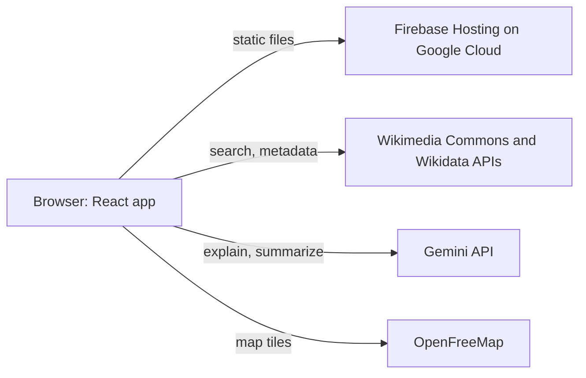
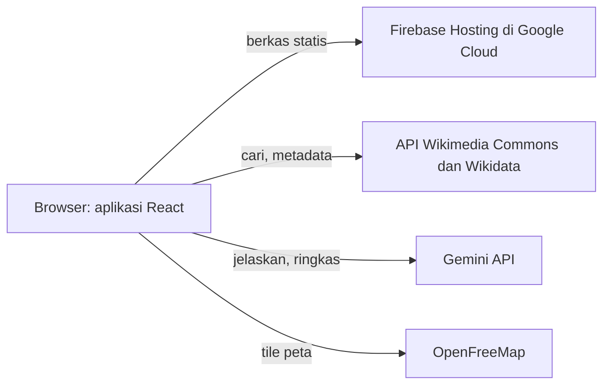

<div align="center">

# WikiGaleri

**A gallery for Wikimedia Commons: find free media, understand it, and reuse it with the right credit.**
**Galeri untuk Wikimedia Commons: temukan media bebas, pahami isinya, dan pakai dengan kredit yang benar.**

[Live demo](https://wikigaleri.web.app) · [English](#english) · [Bahasa Indonesia](#bahasa-indonesia)

Built by **Team Metafora** with Google Gemini and Firebase for the Google Cloud AI Builder Cup.
Dibuat oleh **Tim Metafora** dengan Google Gemini dan Firebase untuk Google Cloud AI Builder Cup.

</div>

---

## English

### The problem

Wikimedia Commons holds more than a hundred million free files, but two things get in the way of using them:

1. **They are hard to find and understand.** Search is built for editors, and a file's page is dense with metadata.
2. **License rules are easy to get wrong.** A file may need credit, may forbid commercial use, or may require you to share your changes under the same license. Missing the credit line or mixing up two licenses is common, and it can take down a student's thesis figure or a small business's brochure.

### What WikiGaleri does

WikiGaleri is a web app that closes that gap. Live at **https://wikigaleri.web.app**.

- Search Commons by keyword, username, category, live feed or a random pick, and filter by media type and license.
- See a map of geotagged photos around any spot, with an optional 3D view of buildings. It opens on the National Monument (Monas), Jakarta.
- Ask Gemini to explain a file in plain language and sum up what its license allows.
- Copy a ready-made credit line (TASL: Title, Author, Source, License) in one click, in English or Indonesian.
- Save files, usernames and categories as bookmarks, and back them up as a JSON file.
- Use it in Indonesian or English, in light or dark mode, on a phone or a desktop.

### Features

| Feature | What it does |
|---|---|
| Gallery and search | Browse images, audio, video, documents and more, with curated topics, a Live Feed of new uploads and a random tab |
| Search by user or category | Open a contributor's uploads and talk page, or walk a category tree through subcategories and parent categories |
| Filters | Narrow results by media type and license (Public Domain, CC BY, CC BY-SA and others) |
| File details | Download sizes, source info, categories and usage, version history and discussion, with a reading mode for documents |
| Gemini assistant | Two short sections per file: what the file is, and what you can do with it |
| Credit line | A TASL credit line in plain text, Markdown, HTML or wikitext, plus a quick-copy modal |
| Nearby map | Find Commons photos around a point, with an area summary from Gemini (or a local summary when Gemini is not available) |
| Bookmarks | Save files, usernames and categories in your browser, and export or import them as JSON |
| Guides | In-app guides for CC licenses, Wikimedia terms and what WikiGaleri is |
| PDF report | Save the Gemini analysis of a file as a PDF |

### How Google AI is used

Gemini 3.8 Flash (through the Gemini API) reads the official Commons metadata (title, description, categories, license, size, location) and writes:

1. **What this file is**: a plain-language explanation, key facts and ideas for using it.
2. **What you can do with it**: a license summary, notes on commercial use and remixing, things to double-check, and a credit line.

For the Nearby map, Gemini also summarizes the area around the chosen point from the titles and descriptions of nearby photos. When no key is set or Gemini cannot be reached, the app shows a clearly labelled local summary instead, and says it was not written by Gemini.

Every AI result carries a notice, with a link to the [Wikimedia AI guidelines](https://meta.wikimedia.org/wiki/Artificial_intelligence/Guidelines). Gemini can be wrong or miss context. The license summary is a guide, not legal advice. Always check the file page on Commons before you reuse anything.

### Architecture and deployment



The app is a single-page React build served by **Firebase Hosting** (project `wikigaleri`, on Google Cloud). All Wikimedia, Gemini and map requests go directly from the browser, so there is no server of our own to run or secure. `firebase.json` serves `dist/` and rewrites every route to `index.html`.

To deploy (needs the [Firebase CLI](https://firebase.google.com/docs/cli) and access to the project):

```bash
npm run build
firebase deploy --only hosting
```

### Tech stack

- React 19, TypeScript, Vite
- Tailwind CSS 4
- MapLibre GL (nearby map, OpenFreeMap tiles)
- Google Gemini API (REST, model `gemini-3.8-flash`, with `gemini-flash-latest` and `gemini-2.5-flash` as fallbacks)
- Wikimedia Commons and Wikidata APIs
- jsPDF and qrcode for the PDF report
- Firebase Hosting for deployment

### Run locally

**Prerequisites:** Node.js 22 or newer.

```bash
git clone https://github.com/affandymurad/wikigaleri.git
cd wikigaleri
npm install
npm run dev
```

Open http://localhost:3000.

**Gemini API key.** The Gemini features need your own key from [Google AI Studio](https://aistudio.google.com/apikey). Open the Gemini key dialog in the app and paste it there. The key is stored only in your browser (`localStorage`) and sent only to Google. Without a key, search, filters, credit lines, the map and bookmarks all still work. Never commit a key to this repository.

`.env.example` lists the variables AI Studio injects when the app runs there (`GEMINI_API_KEY`, `APP_URL`).

### Scripts

| Command | Purpose |
|---|---|
| `npm run dev` | Start the dev server on port 3000 |
| `npm run build` | Build for production into `dist/` |
| `npm run preview` | Preview the production build |
| `npm run lint` | Type-check with TypeScript |

### Project structure

```
src/
  components/   UI: gallery, detail modal, nearby map, bookmarks, guides
  hooks/        Commons gallery, language, dark mode, API key
  services/     Wikimedia API client and Gemini client (prompts live here)
  i18n/         Indonesian and English strings
  utils/        License helpers, credit line and PDF export
```

### Credits and disclaimer

WikiGaleri is an independent project. It is not made, endorsed or run by the Wikimedia Foundation. Every file keeps the license chosen by its author, so follow it when you reuse a file.

Media shown in the app comes from [Wikimedia Commons](https://commons.wikimedia.org). Map data by [OpenStreetMap](https://www.openstreetmap.org/copyright) contributors, tiles by [OpenFreeMap](https://openfreemap.org).

### Team

**Team Metafora**: Affandy Murad (Team Leader) and Ahmad Fauzi (Member). Profile: [affandymurad.github.io](https://affandymurad.github.io/).

---

## Bahasa Indonesia

### Masalahnya

Wikimedia Commons menyimpan lebih dari seratus juta berkas bebas, tetapi ada dua hal yang menghalangi orang memakainya:

1. **Sulit dicari dan dipahami.** Pencariannya dibuat untuk penyunting, dan halaman berkas penuh metadata.
2. **Aturan lisensi gampang salah.** Sebuah berkas mungkin wajib dikreditkan, melarang pemakaian komersial, atau mewajibkan hasil olahanmu dibagikan dengan lisensi yang sama. Kredit yang terlewat atau dua lisensi yang tertukar itu umum terjadi, dan bisa merugikan, misalnya pada gambar skripsi mahasiswa atau brosur usaha kecil.

### Apa yang dilakukan WikiGaleri

WikiGaleri adalah aplikasi web yang menutup celah itu. Tersedia di **https://wikigaleri.web.app**.

- Cari di Commons lewat kata kunci, nama pengguna, kategori, Live Feed, atau pilihan acak, lalu saring berdasarkan jenis media dan lisensi.
- Lihat peta foto bergeotag di sekitar suatu tempat, dengan tampilan 3D gedung sebagai pilihan. Peta dibuka di Monumen Nasional (Monas), Jakarta.
- Minta Gemini menjelaskan isi berkas dengan bahasa sehari-hari dan meringkas apa yang diizinkan lisensinya.
- Salin teks kredit siap pakai (TASL: Judul, Pembuat, Sumber, Lisensi) dengan satu klik, dalam bahasa Indonesia atau Inggris.
- Simpan berkas, nama pengguna, dan kategori sebagai markah, lalu cadangkan sebagai berkas JSON.
- Tersedia dalam bahasa Indonesia dan Inggris, mode terang dan gelap, di ponsel maupun desktop.

### Fitur

| Fitur | Fungsi |
|---|---|
| Galeri dan pencarian | Jelajahi gambar, audio, video, dokumen, dan lainnya, lengkap dengan topik pilihan, Live Feed unggahan terbaru, dan tab acak |
| Cari lewat pengguna atau kategori | Buka unggahan dan halaman pembicaraan seorang kontributor, atau telusuri pohon kategori lewat subkategori dan kategori induk |
| Filter | Saring hasil menurut jenis media dan lisensi (Domain Publik, CC BY, CC BY-SA, dan lainnya) |
| Detail berkas | Ukuran unduhan, info sumber, kategori dan penggunaan, riwayat versi, serta diskusi, dengan mode baca untuk dokumen |
| Asisten Gemini | Dua bagian singkat per berkas: apa isi berkas ini, dan boleh dipakai untuk apa |
| Teks kredit | Teks kredit TASL dalam teks biasa, Markdown, HTML, atau wikitext, plus jendela salin cepat |
| Peta terdekat | Temukan foto Commons di sekitar satu titik, dengan ringkasan area dari Gemini (atau ringkasan lokal bila Gemini tidak tersedia) |
| Markah | Simpan berkas, nama pengguna, dan kategori di browsermu, lalu ekspor atau impor sebagai JSON |
| Panduan | Panduan lisensi CC, ketentuan Wikimedia, dan penjelasan tentang WikiGaleri langsung di aplikasi |
| Laporan PDF | Simpan analisis Gemini sebuah berkas sebagai PDF |

### Cara Google AI dipakai

Gemini 3.8 Flash (lewat Gemini API) membaca metadata resmi dari Commons (judul, deskripsi, kategori, lisensi, ukuran, lokasi), lalu menulis:

1. **Apa isi berkas ini**: penjelasan bahasa awam, fakta penting, dan ide pemakaian.
2. **Boleh dipakai untuk apa**: ringkasan lisensi, catatan soal pemakaian komersial dan remix, hal yang perlu dicek, serta teks kredit.

Untuk peta terdekat, Gemini juga merangkum area di sekitar titik pilihan dari judul dan deskripsi foto di sekitarnya. Bila kunci belum diisi atau Gemini tidak bisa dihubungi, aplikasi menampilkan ringkasan lokal yang diberi label jelas dan menyebut bahwa ringkasan itu bukan tulisan Gemini.

Setiap hasil AI disertai catatan, dengan tautan ke [pedoman AI Wikimedia](https://meta.wikimedia.org/wiki/Artificial_intelligence/Guidelines). Gemini bisa salah atau melewatkan konteks. Ringkasan lisensi hanya penuntun, bukan nasihat hukum. Selalu cek halaman berkas di Commons sebelum memakainya kembali.

### Arsitektur dan deployment



Aplikasi ini berupa build React satu halaman yang disajikan oleh **Firebase Hosting** (proyek `wikigaleri`, di Google Cloud). Semua permintaan ke Wikimedia, Gemini, dan peta langsung dari browser, jadi tidak ada server milik sendiri yang perlu dijalankan atau diamankan. `firebase.json` menyajikan `dist/` dan mengarahkan semua rute ke `index.html`.

Untuk deploy (butuh [Firebase CLI](https://firebase.google.com/docs/cli) dan akses ke proyeknya):

```bash
npm run build
firebase deploy --only hosting
```

### Teknologi

- React 19, TypeScript, Vite
- Tailwind CSS 4
- MapLibre GL (peta terdekat, tile OpenFreeMap)
- Google Gemini API (REST, model `gemini-3.8-flash`, dengan `gemini-flash-latest` dan `gemini-2.5-flash` sebagai cadangan)
- API Wikimedia Commons dan Wikidata
- jsPDF dan qrcode untuk laporan PDF
- Firebase Hosting untuk deployment

### Menjalankan secara lokal

**Prasyarat:** Node.js 22 atau lebih baru.

```bash
git clone https://github.com/affandymurad/wikigaleri.git
cd wikigaleri
npm install
npm run dev
```

Buka http://localhost:3000.

**Kunci API Gemini.** Fitur Gemini butuh kunci milikmu sendiri dari [Google AI Studio](https://aistudio.google.com/apikey). Buka dialog kunci Gemini di aplikasi, lalu tempel kuncinya di sana. Kunci disimpan hanya di browsermu (`localStorage`) dan hanya dikirim ke Google. Tanpa kunci, pencarian, filter, teks kredit, peta, dan markah tetap berfungsi. Jangan pernah meng-commit kunci ke repositori ini.

`.env.example` berisi variabel yang disuntikkan AI Studio saat aplikasi berjalan di sana (`GEMINI_API_KEY`, `APP_URL`).

### Perintah

| Perintah | Fungsi |
|---|---|
| `npm run dev` | Menjalankan server pengembangan di port 3000 |
| `npm run build` | Membangun versi produksi ke folder `dist/` |
| `npm run preview` | Melihat hasil build produksi |
| `npm run lint` | Memeriksa tipe dengan TypeScript |

### Struktur proyek

```
src/
  components/   Antarmuka: galeri, modal detail, peta terdekat, markah, panduan
  hooks/        Galeri Commons, bahasa, mode gelap, kunci API
  services/     Klien API Wikimedia dan klien Gemini (prompt ada di sini)
  i18n/         Teks bahasa Indonesia dan Inggris
  utils/        Pembantu lisensi, teks kredit, dan ekspor PDF
```

### Kredit dan penafian

WikiGaleri adalah proyek independen. Aplikasi ini tidak dibuat, didukung, atau dikelola oleh Wikimedia Foundation. Setiap berkas tetap tunduk pada lisensi pilihan pembuatnya, jadi ikuti lisensi itu saat memakainya kembali.

Media di aplikasi berasal dari [Wikimedia Commons](https://commons.wikimedia.org). Data peta oleh kontributor [OpenStreetMap](https://www.openstreetmap.org/copyright), tile oleh [OpenFreeMap](https://openfreemap.org).

### Tim

**Tim Metafora**: Affandy Murad (Ketua Tim) dan Ahmad Fauzi (Anggota). Profil: [affandymurad.github.io](https://affandymurad.github.io/).
