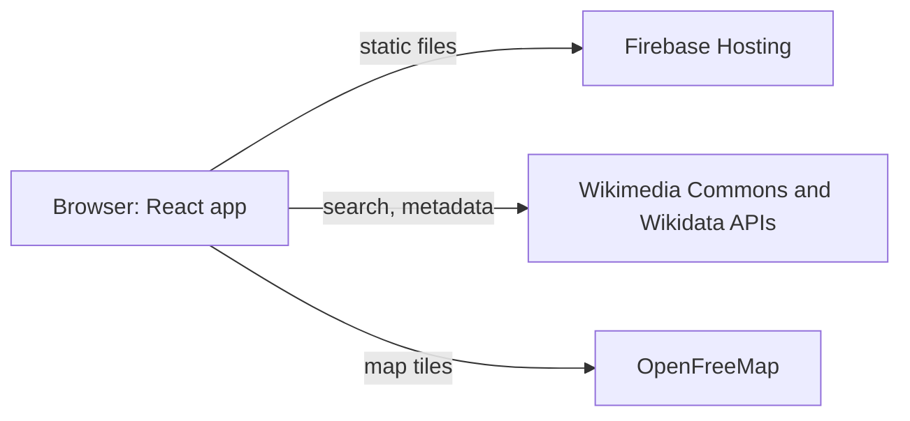
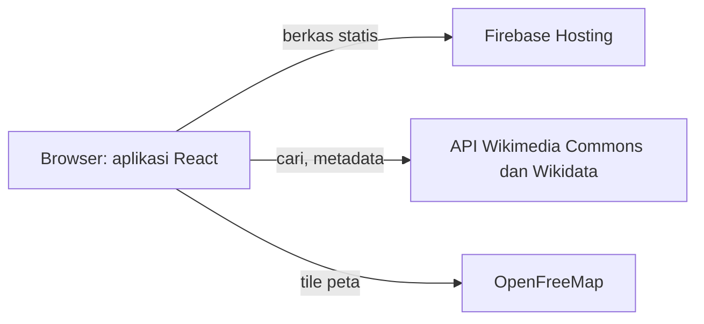

<div align="center">

# WikiGaleri

**A gallery for Wikimedia Commons: find free media, understand it, and reuse it with the right credit.**
**Galeri untuk Wikimedia Commons: temukan media bebas, pahami isinya, dan pakai dengan kredit yang benar.**

[Live demo](https://wikigaleri.web.app) · [English](#english) · [Bahasa Indonesia](#bahasa-indonesia)

Built by **Affandy Murad**.
Dibuat oleh **Affandy Murad**.

</div>

---

## English

### The problem

Wikimedia Commons holds more than a hundred million free files, but two things get in the way of using them:

1. **They are hard to find and understand.** Search is built for editors, and a file's page is dense with metadata.
2. **License rules are easy to get wrong.** A file may need credit, may forbid commercial use, or may require you to share your changes under the same license. Missing the credit line or mixing up two licenses is common, and it can take down a student's thesis figure or a small business's brochure.

### What WikiGaleri does

WikiGaleri is a web app that closes that gap. Live at **https://wikigaleri.web.app**.

- Search Commons by keyword, username, category, live feed or a random pick, and narrow results by media type.
- See a map of geotagged photos around any spot, with an optional 3D view of buildings. It opens on the National Monument (Monas), Jakarta.
- Copy a ready-made credit line (TASL: Title, Author, Source, License) in one click, in English or Indonesian.
- Save files, usernames and categories as bookmarks, and back them up as a JSON file.
- Use it in Indonesian or English, in light or dark mode, on a phone or a desktop.

### Features

| Feature | What it does |
|---|---|
| Gallery and search | Browse images, audio, video, documents and more, with curated topics, a Live Feed of new uploads and a random tab |
| Search by user or category | Open a contributor's uploads and talk page, or walk a category tree through subcategories and parent categories |
| Media-type filter | Narrow results to images, video, audio, documents, 3D models or 360° panoramas |
| 360° panoramas | A "360° Panoramas" filter and a badge on panoramas. Open one and look around by dragging (mouse or touch), scroll or pinch to zoom, with a full-resolution option on desktop. Very wide photos get a "Panorama" badge |
| 3D models (STL) | Find STL files on Commons and rotate, zoom and pan them in the preview (loaded on demand with three.js; models over 12 MB wait for your click) |
| File details | Download sizes, source info, categories and usage, version history and discussion, with a reading mode for documents |
| Fullscreen | Photos, 3D models and 360° panoramas open fullscreen: the browser's own fullscreen where it allows it, otherwise a built-in fullscreen view (Esc closes it) |
| Shareable URLs | Every search is a link: `/?q=batik&type=image&license=pd`, `/?user=Name`, `/?mode=categories&q=Batik`, `/?mode=live`, `random`, `nearby` or `bookmarks`. Each file has its own page named like Commons: `/file/Waterworks_Museum_(85472)bw.jpg`. Back and Forward work as expected |
| Links to other modes | Actions that jump to another mode of the site (a category or username search from a file, a bookmark or a Nearby card, *Table*, *View Details* on a Nearby photo) open in a new tab, so your current results stay where they are |
| Credit line | A TASL credit line in plain text, Markdown, HTML or wikitext, plus a quick-copy modal |
| Nearby map | Find geotagged Commons photos around a point, plus categories, and Wikidata places without a photo, for the visible map area (see below) |
| Bookmarks | Save files, usernames and categories in your browser, and export or import them as JSON |
| Guides | In-app guides for CC licenses, Wikimedia terms and what WikiGaleri is |

### Architecture and deployment



The site is a single-page React build served by **Firebase Hosting** (project `wikigaleri`, free Spark plan). Wikimedia and map requests go straight from the browser.

To deploy (needs the Firebase CLI and access to the project):

```bash
npm run build
firebase deploy --only hosting
```

### Tech stack

- React 19, TypeScript, Vite
- Tailwind CSS 4
- MapLibre GL (nearby map, OpenFreeMap tiles)
- Wikimedia Commons and Wikidata APIs
- three.js (loaded on demand) for the interactive STL and 360° panorama viewers
- jsPDF for PDF exports
- Firebase Hosting for the site

### Run locally

**Prerequisites:** Node.js 24 or newer (see `.nvmrc`).

```bash
git clone https://github.com/affandymurad/wikigaleri.git
cd wikigaleri
npm install
npm run dev
```

Open http://localhost:3000. Search, filters, credit lines, the map and bookmarks work right away.

### Nearby: categories with coordinates and Wikidata places

The **Find Nearby Commons** button on the Nearby map runs one search for the visible map area and fills a side panel with three lists, switchable by chip:

- **Photos**: geotagged Commons files in the visible map area (the 50 closest to the map center).
- **Categories with coordinates**: Commons categories whose own page has coordinates (set by a template such as `{{Object location}}` or `{{Coord}}`, or taken from the linked Wikidata item), read directly from Commons geosearch and shown as purple pins.
- **Wikidata**: Wikidata items that have coordinates (P625) in the area. Items with an image (P18) show a thumbnail; items without one carry a *No photo* badge, are listed first, and are candidates for new photos. Items linked to a Commons category (via P373 or a Commons sitelink) also get a *Search in category* badge. Pins are blue for items with a photo and green for items without. Clicking an item flies the map to it and opens an info card.


The active list is kept in the URL: `/?mode=nearby&list=catcoords` or `list=wikidata` (Photos is the default and is not written).

**Limits you should know about**

- The photo list shows at most 50 files, and the coordinate-category list at most 500 categories. If the area holds more, the panel says the list is partial; zoom in for fuller results. The category list is only as complete as the coordinates on Commons: categories without coordinates are not shown.
- All three lists use the visible map area, which must be under about 6 km wide (3 km radius from the map center). Wider than that, no request is sent and you are asked to zoom in.
- The Wikidata list returns at most 1000 items and the query times out after 15 seconds. If one list fails to load, the others still show.
- Results are cached per area and zoom for the session, and an older request is cancelled when the map moves.

### Scripts

| Command | Purpose |
|---|---|
| `npm run dev` | Start the dev server on port 3000 |
| `npm run build` | Build for production into `dist/` |
| `npm run preview` | Preview the production build |
| `npm run lint` | Type-check with TypeScript |
| `npm test` | Run unit tests (Node's built-in test runner, no extra dependency) |

### Project structure

```
src/
  components/   UI: gallery, file detail page (/file/<id>), nearby map, bookmarks, guides
  hooks/        Commons gallery, language, dark mode
  services/     Wikimedia API client
  i18n/         Indonesian and English strings
  utils/        License helpers, credit line and PDF export
```

### Credits and disclaimer

WikiGaleri is an independent project. It is not made, endorsed or run by the Wikimedia Foundation. Every file keeps the license chosen by its author, so follow it when you reuse a file.

Media shown in the app comes from [Wikimedia Commons](https://commons.wikimedia.org). Map data by [OpenStreetMap](https://www.openstreetmap.org/copyright) contributors, tiles by [OpenFreeMap](https://openfreemap.org).

### Author

**Affandy Murad**. Profile: [affandymurad.github.io](https://affandymurad.github.io/).

---

## Bahasa Indonesia

### Masalahnya

Wikimedia Commons menyimpan lebih dari seratus juta berkas bebas, tetapi ada dua hal yang menghalangi orang memakainya:

1. **Sulit dicari dan dipahami.** Pencariannya dibuat untuk penyunting, dan halaman berkas penuh metadata.
2. **Aturan lisensi gampang salah.** Sebuah berkas mungkin wajib dikreditkan, melarang pemakaian komersial, atau mewajibkan hasil olahanmu dibagikan dengan lisensi yang sama. Kredit yang terlewat atau dua lisensi yang tertukar itu umum terjadi, dan bisa merugikan, misalnya pada gambar skripsi mahasiswa atau brosur usaha kecil.

### Apa yang dilakukan WikiGaleri

WikiGaleri adalah aplikasi web yang menutup celah itu. Tersedia di **https://wikigaleri.web.app**.

- Cari di Commons lewat kata kunci, nama pengguna, kategori, Live Feed, atau pilihan acak, lalu saring berdasarkan jenis media.
- Lihat peta foto bergeotag di sekitar suatu tempat, dengan tampilan 3D gedung sebagai pilihan. Peta dibuka di Monumen Nasional (Monas), Jakarta.
- Salin teks kredit siap pakai (TASL: Judul, Pembuat, Sumber, Lisensi) dengan satu klik, dalam bahasa Indonesia atau Inggris.
- Simpan berkas, nama pengguna, dan kategori sebagai markah, lalu cadangkan sebagai berkas JSON.
- Tersedia dalam bahasa Indonesia dan Inggris, mode terang dan gelap, di ponsel maupun desktop.

### Fitur

| Fitur | Fungsi |
|---|---|
| Galeri dan pencarian | Jelajahi gambar, audio, video, dokumen, dan lainnya, lengkap dengan topik pilihan, Live Feed unggahan terbaru, dan tab acak |
| Cari lewat pengguna atau kategori | Buka unggahan dan halaman pembicaraan seorang kontributor, atau telusuri pohon kategori lewat subkategori dan kategori induk |
| Filter jenis media | Saring hasil menjadi gambar, video, audio, dokumen, model 3D, atau panorama 360° |
| Panorama 360° | Filter "Panorama 360°" dan badge pada panorama. Buka satu panorama lalu lihat sekeliling dengan menyeret (mouse atau sentuh), gulir atau cubit untuk zoom, dengan opsi resolusi penuh di desktop. Foto yang sangat lebar mendapat badge "Panorama" |
| Model 3D (STL) | Temukan berkas STL di Commons, lalu putar, perbesar, dan geser di preview (dimuat saat dibutuhkan dengan three.js; model di atas 12 MB menunggu klik Anda) |
| Detail berkas | Ukuran unduhan, info sumber, kategori dan penggunaan, riwayat versi, serta diskusi, dengan mode baca untuk dokumen |
| Layar penuh | Foto, model 3D, dan panorama 360° bisa dibuka layar penuh: layar penuh bawaan browser bila diizinkan, kalau tidak, tampilan layar penuh buatan sendiri (Esc menutupnya) |
| URL yang bisa dibagikan | Setiap pencarian punya tautan: `/?q=batik&type=image&license=pd`, `/?user=Nama`, `/?mode=categories&q=Batik`, `/?mode=live`, `random`, `nearby` atau `bookmarks`. Setiap berkas punya halaman bernama seperti di Commons: `/file/Waterworks_Museum_(85472)bw.jpg`. Tombol Kembali dan Maju berfungsi |
| Tautan ke mode lain | Aksi yang berpindah ke mode lain di situs ini (pencarian kategori atau nama pengguna dari sebuah berkas, markah atau kartu Terdekat, *Tabel*, *Buka Detail Berkas* pada foto Terdekat) dibuka di tab baru, sehingga hasil Anda saat ini tidak hilang |
| Teks kredit | Teks kredit TASL dalam teks biasa, Markdown, HTML, atau wikitext, plus jendela salin cepat |
| Peta terdekat | Temukan foto Commons bergeotag di sekitar satu titik, beserta kategori dan tempat Wikidata yang belum punya foto, untuk area peta yang terlihat (lihat di bawah) |
| Markah | Simpan berkas, nama pengguna, dan kategori di browsermu, lalu ekspor atau impor sebagai JSON |
| Panduan | Panduan lisensi CC, ketentuan Wikimedia, dan penjelasan tentang WikiGaleri langsung di aplikasi |

### Arsitektur dan deployment



Situsnya berupa build React satu halaman yang disajikan oleh **Firebase Hosting** (proyek `wikigaleri`, paket Spark gratis). Permintaan ke Wikimedia dan peta langsung dari browser.

Untuk deploy (butuh Firebase CLI dan akses ke proyeknya):

```bash
npm run build
firebase deploy --only hosting
```

### Teknologi

- React 19, TypeScript, Vite
- Tailwind CSS 4
- MapLibre GL (peta terdekat, tile OpenFreeMap)
- API Wikimedia Commons dan Wikidata
- three.js (dimuat saat dibutuhkan) untuk penampil STL dan panorama 360° interaktif
- jsPDF untuk ekspor PDF
- Firebase Hosting untuk situs

### Menjalankan secara lokal

**Prasyarat:** Node.js 24 atau lebih baru (lihat `.nvmrc`).

```bash
git clone https://github.com/affandymurad/wikigaleri.git
cd wikigaleri
npm install
npm run dev
```

Buka http://localhost:3000. Pencarian, filter, teks kredit, peta, dan markah langsung berfungsi.

### Terdekat: kategori ber-koordinat dan tempat di Wikidata

Tombol **Cari Commons Terdekat** di peta Terdekat menjalankan satu pencarian untuk area peta yang terlihat dan mengisi panel samping dengan tiga daftar yang bisa dipilih lewat chip:

- **Foto**: berkas Commons bergeotag di area peta yang terlihat (50 yang terdekat dari titik tengah peta).
- **Kategori ber-koordinat**: kategori Commons yang halamannya sendiri punya koordinat (dari template seperti `{{Object location}}` atau `{{Coord}}`, atau dari item Wikidata yang terhubung), dibaca langsung dari geosearch Commons dan tampil sebagai pin ungu.
- **Wikidata**: item Wikidata yang punya koordinat (P625) di area itu. Item yang punya gambar (P18) menampilkan thumbnail; item tanpa gambar diberi badge *Tanpa foto*, ditampilkan paling atas, dan cocok jadi sasaran foto baru. Item yang terhubung ke kategori Commons (lewat P373 atau sitelink Commons) juga mendapat badge *Cari di kategori*. Pin biru untuk item berfoto dan hijau untuk yang tanpa foto. Mengklik item menggeser peta ke titiknya dan membuka kartu info.


Daftar yang aktif disimpan di URL: `/?mode=nearby&list=catcoords` atau `list=wikidata` (Foto adalah bawaan dan tidak ditulis).

**Batasan yang perlu diketahui**

- Daftar foto menampilkan paling banyak 50 berkas, dan daftar kategori ber-koordinat paling banyak 500 kategori. Bila area berisi lebih banyak, panel memberi tahu bahwa daftarnya tidak lengkap; perbesar peta untuk hasil yang lebih lengkap. Daftar kategori hanya selengkap koordinat yang ada di Commons: kategori tanpa koordinat tidak ditampilkan.
- Ketiga daftar memakai area peta yang terlihat, yang lebarnya harus di bawah sekitar 6 km (radius 3 km dari titik tengah peta). Lebih lebar dari itu, tidak ada permintaan yang dikirim dan Anda diminta memperbesar peta.
- Daftar Wikidata mengembalikan paling banyak 1000 item dan kuerinya berhenti setelah 15 detik. Bila satu daftar gagal dimuat, daftar lainnya tetap tampil.
- Hasil disimpan di cache per area dan zoom selama sesi, dan permintaan lama dibatalkan saat peta bergeser.

### Perintah

| Perintah | Fungsi |
|---|---|
| `npm run dev` | Menjalankan server pengembangan di port 3000 |
| `npm run build` | Membangun versi produksi ke folder `dist/` |
| `npm run preview` | Melihat hasil build produksi |
| `npm run lint` | Memeriksa tipe dengan TypeScript |
| `npm test` | Menjalankan uji unit (test runner bawaan Node, tanpa dependensi tambahan) |

### Struktur proyek

```
src/
  components/   Antarmuka: galeri, halaman detail berkas (/file/<id>), peta terdekat, markah, panduan
  hooks/        Galeri Commons, bahasa, mode gelap
  services/     Klien API Wikimedia
  i18n/         Teks bahasa Indonesia dan Inggris
  utils/        Pembantu lisensi, teks kredit, dan ekspor PDF
```

### Kredit dan penafian

WikiGaleri adalah proyek independen. Aplikasi ini tidak dibuat, didukung, atau dikelola oleh Wikimedia Foundation. Setiap berkas tetap tunduk pada lisensi pilihan pembuatnya, jadi ikuti lisensi itu saat memakainya kembali.

Media di aplikasi berasal dari [Wikimedia Commons](https://commons.wikimedia.org). Data peta oleh kontributor [OpenStreetMap](https://www.openstreetmap.org/copyright), tile oleh [OpenFreeMap](https://openfreemap.org).

### Pembuat

**Affandy Murad**. Profil: [affandymurad.github.io](https://affandymurad.github.io/).
